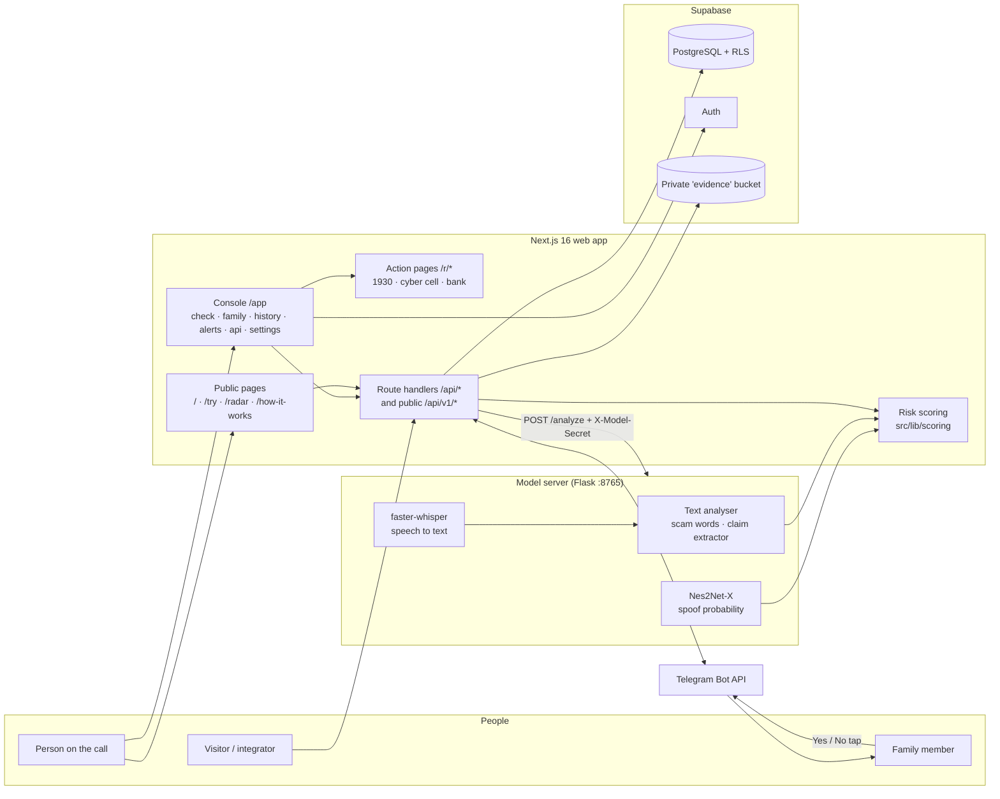
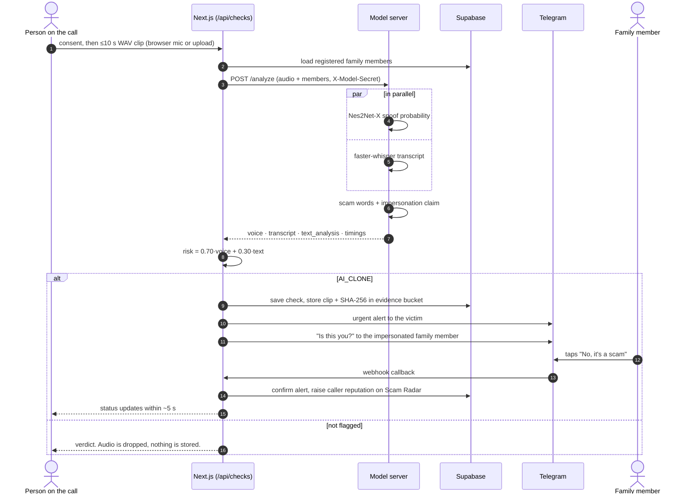
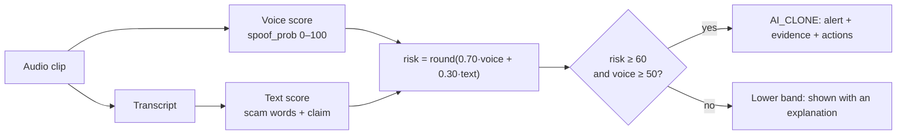
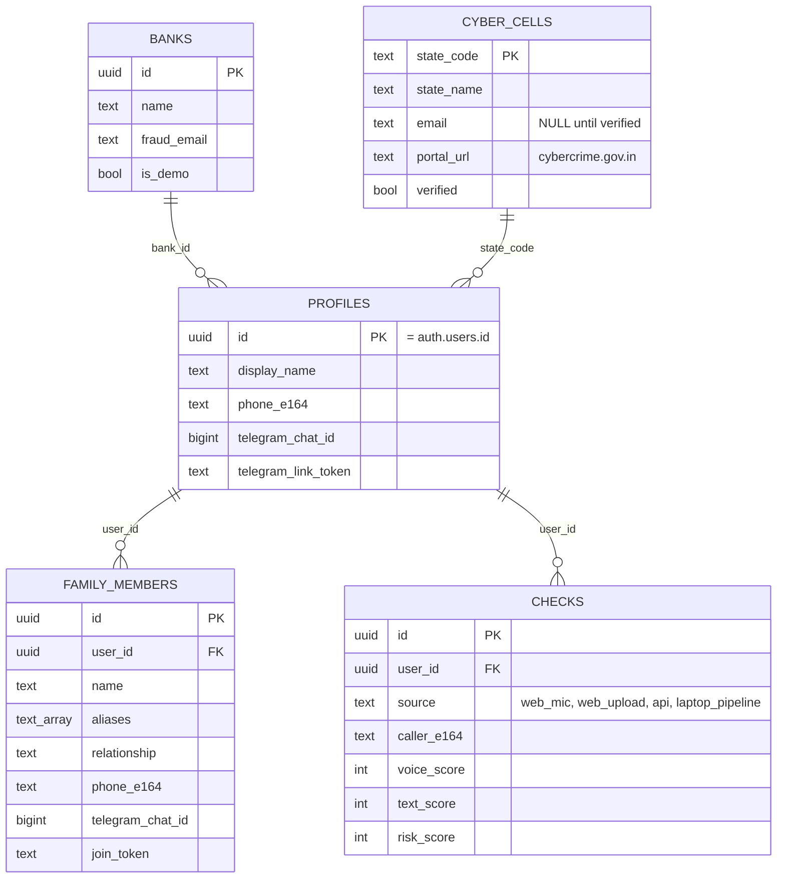

<!-- prettier-ignore -->
<div align="center">

# VaaniX

**Catch AI voice-clone scam calls while they are still ringing, and warn the family before the money moves.**

<a href="https://52.62.8.151.sslip.io"></a>
<a href="https://52.62.8.151.sslip.io/try"></a>

<a href="https://github.com/vandit-bajaj/VaaniX/actions/workflows/ci.yml"></a>


[Overview](#overview) • [Features](#features) • [How it works](#how-it-works) • [Getting started](#getting-started) • [Deploying to AWS](#deploying-to-aws) • [Status](#status-and-limitations) • [Privacy](#privacy-and-security)

</div>

> [!TIP]
> **Live:** [52.62.8.151.sslip.io](https://52.62.8.151.sslip.io). Open the console with **Open App** (no account needed), or upload a short clip on [`/try`](https://52.62.8.151.sslip.io/try).

| 🎙️ 10-second check | 👨‍👩‍👧 Family verification | 📡 Scam Radar | 🚨 Golden-hour actions |
|:---:|:---:|:---:|:---:|
| Acoustic spoof score + Hindi/Hinglish scam-language analysis | The impersonated person confirms or denies with one Telegram tap | Community reputation for caller numbers | 1930 speed-dial, cyber-cell draft, bank freeze request |

VaaniX is a scam-defence platform for India's voice-clone fraud problem. A caller who sounds exactly like your son, your father or a police officer asks for money *right now*. VaaniX listens to a short clip of that call, scores how likely the voice is synthetic, reads what is being said, and alerts the people who can stop the transfer, in seconds, over Telegram.

## Overview

A voice-clone scam works because the victim has no way to check, in the moment, whether the voice is real. VaaniX gives them three things:

- **A check:** a 10-second clip is scored for acoustic spoofing and for scam language (Hindi, Hinglish and English).
- **A second opinion from the family:** the person being impersonated gets a Telegram message, *"Someone is calling with your voice. Is this you?"*, and one tap confirms or denies it.
- **A fast next step:** a one-tap path to the **1930** cyber-crime helpline, a pre-filled complaint to the state cyber cell, and a freeze request to the bank, all with a SHA-256 digest of the evidence.

It serves three kinds of people:

- **The person on the call** runs a check from the web console and gets a verdict and clear next actions.
- **The family member being impersonated** answers one Telegram question that confirms or kills the alert.
- **The community**, through Scam Radar, learns which phone numbers are being reported.

## Features

| | |
|---|---|
| **10-second check** | **Nes2Net-X** (a wav2vec 2.0 XLSR-53 front end, 300M parameters) gives an acoustic spoof probability from 0 to 100. **faster-whisper** transcribes the clip, and a Hindi, Hinglish and English scam vocabulary (arrest, police, OTP, customs, emergency) is matched against it. Both run in parallel. |
| **Transparent risk score** | `risk = round(0.70 × voice + 0.30 × text)`. A call is flagged `AI_CLONE` when `risk ≥ 60` **and** `voice ≥ 50`. Every weight and cut-off lives in one file, [`src/lib/scoring/config.ts`](src/lib/scoring/config.ts), so it can be tuned against real audio. |
| **Who is the caller pretending to be?** | The text analyser extracts impersonation claims (*"Papa"*, *"Beta"*, *"Police Officer"*) and matches them to the family members the user registered. |
| **Two-way Telegram alerts** | The victim gets an urgent card with the score and scam type. The impersonated family member gets *"Is this you? [No, it's a scam] [Yes, it's me]"*. Answering "No" confirms the alert and raises the caller's reputation on Scam Radar. |
| **Scam Radar** | A community reputation lookup for phone numbers. A number becomes `potential_scam` when **3 distinct reporters** flag it within 24 hours, or on any confirmed `impersonation_denied`. The threshold is configurable with `RADAR_THRESHOLD`. |
| **Golden-hour actions** | `/r/call1930` is a speed-dial page for the national helpline. `/r/cyber/[id]` drafts a state cyber-cell complaint (a pre-filled email, kept to 2,000 characters for browser compatibility). `/r/bank/[id]` drafts a bank freeze request. |
| **Public API** | `/api/v1/analyze`, `/api/v1/complaint`, `/api/v1/radar/lookup` and `/api/v1/evidence/[id]`, authenticated with API keys that users create in the console. See [`docs/API.md`](docs/API.md). |
| **No fake results** | If the model server is unreachable the app says so. If the model runs in stub mode, the result carries a **Demo Mode** badge. See [Status and limitations](#status-and-limitations). |

## How it works

### High-level design



### One check, end to end



### Risk score



If no speech is detected, the text score does not count, and the explanation says so.

### Data model

Twelve tables live in [`supabase/migrations/`](supabase/migrations). The core five:



Row Level Security ([`0002_rls.sql`](supabase/migrations/0002_rls.sql)) keeps every user's checks, alerts and family contacts private to them.

### Design rules

1. **The score is arithmetic, not a vibe.** The verdict comes from a published formula and thresholds in one config file.
2. **Say what is real.** Stub results are badged, an offline model is reported as offline, and cyber-cell emails are shown only if verified.
3. **Collect as little as possible.** Clips that are not flagged are processed in memory and dropped.
4. **The family decides.** A "No, it's a scam" tap from the impersonated person is the strongest signal in the system.

## Getting started

You need Node.js 20+, npm, Python 3.10 (for the real model), a Supabase project, and a Telegram bot token from `@BotFather`.

**1. Install the web app**
```bash
git clone https://github.com/vandit-bajaj/VaaniX.git
cd VaaniX
npm install --legacy-peer-deps
```

**2. Run the model server**
```bash
python3.10 -m venv .venv
source .venv/bin/activate
pip install -r requirements.txt
bash run_server.sh            # Flask on http://127.0.0.1:8765
```
For the full model, also install `fairseq` and download the ~5 GB of weights, as described in [`voice_detection_pipeline/README.md`](voice_detection_pipeline/README.md). To try the UI without the weights, run the server with `VOICE_DETECTION_STUB=1`.

**3. Configure the environment**
```bash
cp .env.example .env.local
```

| Variable | What it is for |
|---|---|
| `NEXT_PUBLIC_SITE_URL` | Public URL of the app (used for links and the Telegram webhook). |
| `NEXT_PUBLIC_SUPABASE_URL`, `NEXT_PUBLIC_SUPABASE_ANON_KEY` | Supabase client access. |
| `SUPABASE_SERVICE_ROLE_KEY` | Server-side admin access. Never expose it to the browser. |
| `MODEL_SERVER_URL` | Where the Flask model server is. Defaults to `http://127.0.0.1:8765`. |
| `MODEL_SERVER_SECRET` | Shared secret sent as `X-Model-Secret`. |
| `TELEGRAM_BOT_TOKEN`, `TELEGRAM_WEBHOOK_SECRET` | The bot and webhook verification. |
| `LINK_SIGNING_SECRET` | Signs one-tap action links. |
| `RADAR_THRESHOLD` | Distinct reporters needed to flag a number (default 3). |
| `LOCAL_DB_PATH` | Local store file used when Supabase is not configured (default `.data/local-db.json`). |

**4. Create the database.** In the Supabase SQL editor, run the files in `supabase/migrations/` in order: `0001_init.sql`, `0002_rls.sql`, `0003_seed_banks_and_states.sql`.

**5. Register the Telegram webhook** (needs a public HTTPS URL):
```bash
npx tsx scripts/set-telegram-webhook.ts https://your-public-domain.com
```

**6. Start the app**
```bash
npm run dev                   # http://localhost:3000
```

> [!WARNING]
> Browser microphone capture and the Telegram webhook both need **HTTPS**. `localhost` is fine for the mic; the webhook needs a public URL.

### Commands

| Command | What it does |
|---|---|
| `npm run dev` · `npm run build` · `npm start` | Develop, build and serve the web app. |
| `npm run lint` · `npm run typecheck` | ESLint and TypeScript checks. |
| `npm test` | Vitest unit and integration tests. |
| `npm run test:e2e` | Playwright browser tests. |
| `pytest voice_detection_pipeline/tests/` | Model-server and text-analysis tests (stub mode). |
| `bash run_server.sh` | Start the model server. |

GitHub Actions ([`.github/workflows/ci.yml`](.github/workflows/ci.yml)) runs lint, types, Vitest, the production build and the Python tests on every push and pull request.

## Deploying to AWS

The repo includes a single-server setup: one EC2 instance running Docker Compose with the web app, the model server and Caddy (automatic HTTPS).

| File | Role |
|---|---|
| [`Dockerfile`](Dockerfile) | Multi-stage build of the Next.js app (`output: "standalone"`). |
| [`voice_detection_pipeline/Dockerfile.prod`](voice_detection_pipeline/Dockerfile.prod) | Lightweight gunicorn image for the model server, in stub mode. |
| [`deploy/docker-compose.prod.yml`](deploy/docker-compose.prod.yml) | Web, model server and Caddy together. The model server is not published to the internet. |
| [`deploy/Caddyfile`](deploy/Caddyfile) | HTTPS reverse proxy for `SITE_HOST`. |

On the server, put your settings in `deploy/.env` (at minimum `SITE_HOST`, `MODEL_SERVER_SECRET`, `LINK_SIGNING_SECRET`; add the Supabase and Telegram values when you have them) and run `docker compose -f deploy/docker-compose.prod.yml up -d --build`.

`SITE_HOST` can be a real domain, or `<elastic-ip>.sslip.io` for a free HTTPS hostname without one. `NEXT_PUBLIC_*` values are baked in at build time, so rebuild after changing them.

The current deployment runs on a `c7i-flex.large` in `ap-southeast-2` at [52.62.8.151.sslip.io](https://52.62.8.151.sslip.io).

> [!NOTE]
> **Without Supabase**, the app runs on a built-in local store: a JSON file at `LOCAL_DB_PATH` (default `.data/local-db.json`, kept in the `app_data` Docker volume) and a single local user, so the console works with no sign-in. Set the Supabase variables to switch to Postgres, Auth and RLS.
>
> **The production image runs the model server in stub mode**, so scores are placeholders and the UI marks them as such. Real detection needs a larger instance, the `fairseq` install and the ~5 GB of weights (see [`voice_detection_pipeline/README.md`](voice_detection_pipeline/README.md)).

## Status and limitations

- **Model accuracy:** 95% in our internal tests. Test-set details are coming soon, so no benchmark comparison is claimed.
- **Latency:** about 10 seconds per check on our demo machine (CPU).
- **Stub mode** returns random scores so the interface can be tested. It is always labelled, and never presented as a detection.
- **Scoring weights and thresholds** (0.70 / 0.30, 60, 50) are engineering baselines, not yet tuned on a large real-audio set.
- **Cyber-cell emails** are filled in only from verified government sources. Until then, VaaniX shows the National Cyber Crime Reporting Portal ([cybercrime.gov.in](https://cybercrime.gov.in)) and the **1930** helpline.
- **Android:** the `android/` module (Payment Guard, live overlay) is a prototype and is not part of the website.
- **`backend/`** is an earlier FastAPI prototype. The website runs on Next.js route handlers and Supabase.

Open decisions are tracked in [`OPEN_QUESTIONS.md`](OPEN_QUESTIONS.md).

## Privacy and security

- **Ephemeral audio:** clips that are not flagged are processed in memory and dropped.
- **30-day evidence retention:** flagged `AI_CLONE` clips are stored in a private Supabase bucket with a SHA-256 digest, and kept for 30 days (`EVIDENCE_RETENTION_DAYS`).
- **User isolation:** Row Level Security stops one account reading another's checks, alerts or family contacts.
- **Consent first:** the live interface asks for explicit confirmation before recording or analysing call audio. Users can delete their account and transcript history at any time.
- **Model server protection:** the model server checks an `X-Model-Secret` header, rejects clips over 3 MB, and should only be reachable from the web app.
- **Rate limits:** the public `/try` demo allows 5 checks per IP per hour.
- **Secrets stay out of git:** Telegram and Supabase credentials are read from environment variables only.

## Repository layout

```
src/              Next.js app: pages, route handlers, scoring, Telegram, Supabase clients
  app/            (public) site · /app console · /r action pages · /api and /api/v1
  lib/            scoring · radar · telegram · supabase · complaints · API keys
  components/     UI primitives, check results, family graph, marketing blocks
voice_detection_pipeline/   Flask model server, Nes2Net-X runner, text analyser, tests
supabase/migrations/        Schema, RLS policies, seed data
data/             Scam vocabulary (scam_words.yaml)
deploy/           Docker Compose + Caddy for a single-server AWS setup
docs/             API reference, demo script, test runs
tests/e2e/        Playwright tests
scripts/          Telegram webhook setup
android/          Android prototype (not part of the website)
backend/          Earlier FastAPI prototype (superseded)
```

Contributor notes for AI assistants are in [`AGENTS.md`](AGENTS.md).

## Credits and licences

- **Web:** Next.js, React, Tailwind CSS, Radix UI, Framer Motion, Supabase, Sonner, Lucide.
- **Model server:** PyTorch, fairseq, Flask, faster-whisper, librosa, RapidFuzz, indic-transliteration.
- **Voice model:** Nes2Net-X on the wav2vec 2.0 XLSR-53 front end. Check each project's licence before redistributing weights.
- **Helplines and portals:** National Cyber Crime Reporting Portal and the 1930 helpline are run by the Government of India.

VaaniX is released under the MIT License (no `LICENSE` file has been added to the repo yet).
